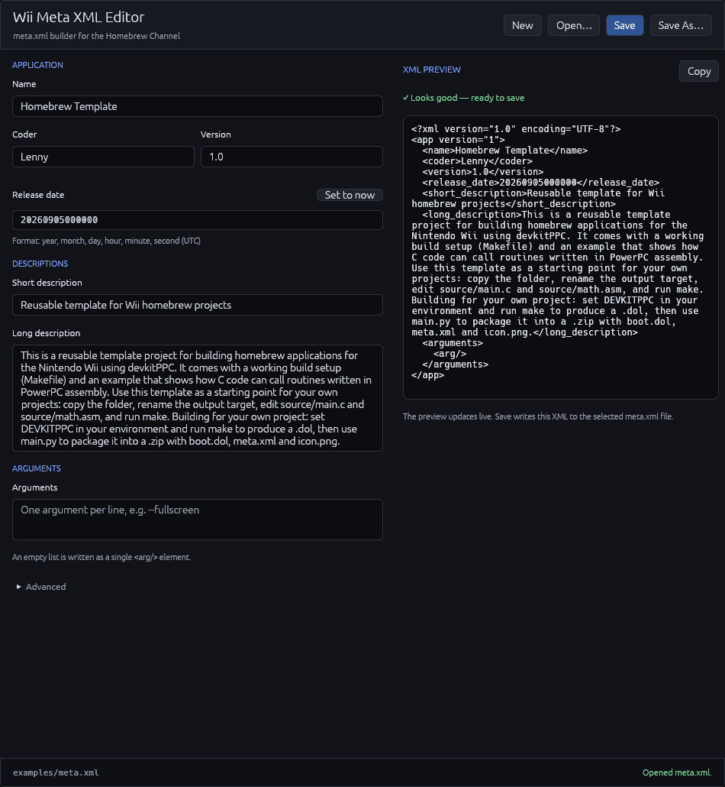

# Wii Meta XML Editor

A small, focused desktop editor for **Wii Homebrew Channel `meta.xml` files**, written in Rust with [egui/eframe](https://github.com/emilk/egui). It has a dark UI, a live XML preview and basic validation, so you can create a new `meta.xml` or edit an existing one without touching the XML by hand.



## Features

- Edit all common meta.xml fields:
  - name
  - coder
  - version
  - release date (`YYYYMMDDHHMMSS`)
  - short description
  - long description
  - arguments (one `<arg>` per line)
  - the `<app version="…">` attribute
- Live XML preview, generated exactly in the format used by the Homebrew Channel
- Validation for required fields and the 14-digit release date
- **New**, **Open…**, **Save** and **Save As…** with native file dialogs
- Open an existing file by passing it on the command line or by dropping it onto the window
- "Set to now" button for the release date (UTC)
- Dark theme, English UI
- Keyboard shortcuts: `Ctrl+N`, `Ctrl+O`, `Ctrl+S`, `Ctrl+Shift+S`

## Downloads

Prebuilt packages are attached to the [latest release](https://github.com/lennybytes/wii-homebrew-xml-editor/releases/latest):

- **Debian/Ubuntu** — `wii-meta-editor_0.1.0_amd64.deb`
  ```sh
  sudo apt install ./wii-meta-editor_0.1.0_amd64.deb
  ```
- **Fedora/openSUSE** — `wii-meta-editor-0.1.0-1.x86_64.rpm`
  ```sh
  sudo dnf install ./wii-meta-editor-0.1.0-1.x86_64.rpm
  # openSUSE: sudo zypper install --allow-unsigned-rpm ./wii-meta-editor-0.1.0-1.x86_64.rpm
  ```
- **Void Linux** — `wii-meta-editor-0.1.0_1.x86_64.xbps`
  ```sh
  xbps-rindex -a wii-meta-editor-0.1.0_1.x86_64.xbps
  sudo xbps-install -R . wii-meta-editor
  ```
- **AppImage (any Linux)** — `Wii_Homebrew_XML_Editor-0.1.0-x86_64.AppImage`
  ```sh
  chmod +x Wii_Homebrew_XML_Editor-0.1.0-x86_64.AppImage
  ./Wii_Homebrew_XML_Editor-0.1.0-x86_64.AppImage
  # if FUSE is not available:
  ./Wii_Homebrew_XML_Editor-0.1.0-x86_64.AppImage --appimage-extract-and-run
  ```
- **Windows 10/11 (64-bit)** — `wii-meta-editor-0.1.0-windows-x86_64.exe`

The packages and the Windows executable are unsigned. Windows SmartScreen may show a warning for the `.exe`.

## Build and run

You need a recent Rust toolchain with support for edition 2024 (Rust 1.85 or newer). A `Makefile` is included for the common tasks:

```sh
make release                 # optimized build
make run                     # run the app
make run ARGS=examples/meta.xml
make test                    # unit tests
make install                 # install to /usr/local (PREFIX=... to change)
```

The direct Cargo commands work too:

```sh
cargo build --release
./target/release/wii-meta-editor
```

Or run it directly, optionally with a file to open:

```sh
cargo run --release
cargo run --release -- examples/meta.xml
```

### Linux dependencies
The GUI uses Wayland or X11 and OpenGL. Typical packages on Debian/Ubuntu:

```sh
sudo apt install build-essential pkg-config libxkbcommon-dev libwayland-dev \
    libx11-dev libxcursor-dev libxrandr-dev libxi-dev libgl1-mesa-dev
```

On Void Linux the corresponding `-devel` packages from the `base-devel`/graphics stack are enough.

File dialogs use the XDG desktop portal. Make sure `xdg-desktop-portal` and a portal backend for your desktop are installed and running (for example `xdg-desktop-portal-gtk`, `xdg-desktop-portal-hyprland` or `xdg-desktop-portal-kde`). Without a portal, the Open/Save dialogs may not appear; drag & drop and command-line opening still work.

## Usage

1. Start the app and fill in the fields on the left. The XML preview on the right updates immediately.
2. Use **Set to now** to fill the release date with the current UTC time, or type a timestamp yourself.
3. For arguments, put **one argument per line**. Example:

   ```text
   --fullscreen
   --debug
   ```

   An empty list is written as a single `<arg/>` element, which is what many homebrew templates use.
4. Click **Save** (or press `Ctrl+S`). If the file has no path yet, you will be asked where to save it. Use **Save As…** to save a copy.
5. Use **Open…**, drag a `meta.xml` onto the window, or start the app with a path to edit an existing file.

Validation messages are only hints: you can still save an incomplete file if you want to.

## meta.xml format

The generated file looks like this:

```xml
<?xml version="1.0" encoding="UTF-8"?>
<app version="1">
  <name>Homebrew Template</name>
  <coder>Lenny</coder>
  <version>1.0</version>
  <release_date>20260905000000</release_date>
  <short_description>Reusable template for Wii homebrew projects</short_description>
  <long_description>This is a reusable template project for building homebrew applications for the Nintendo Wii using devkitPPC.</long_description>
  <arguments>
    <arg/>
  </arguments>
</app>
```

The release date must have exactly 14 digits: four-digit year, month, day, hour, minute and second (for example `20260905000000`). Characters that are special in XML (`&`, `<`, `>`) are escaped automatically.

When an existing file is opened, unknown or additional XML elements are ignored and saving rewrites the document in the standard layout above.

## Project structure

```text
src/
  main.rs   application entry point and window setup
  app.rs    egui user interface, file handling, dark theme
  meta.rs   meta.xml model, parser, writer and validation
examples/
  meta.xml  sample file you can open in the editor
packaging/
  nfpm.yaml                  .deb and .rpm packaging config
  wii-meta-editor.desktop    desktop entry
  wii-meta-editor.svg/.png   application icon
  AppRun                     AppImage launcher
Makefile                    build, test, run and install shortcuts
```

Unit tests for parsing, writing and validation:

```sh
cargo test
```
